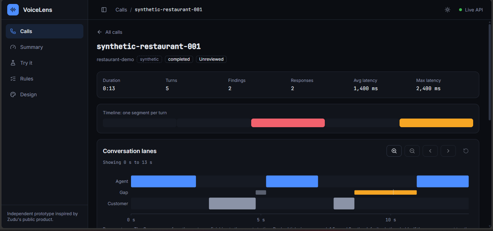
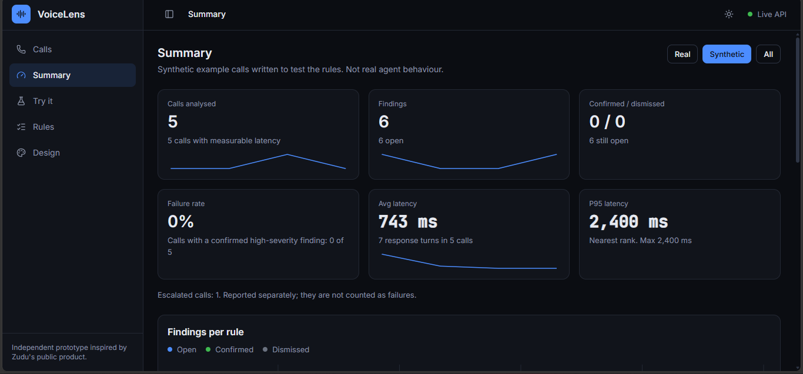
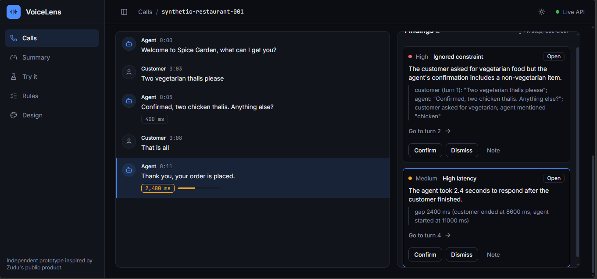
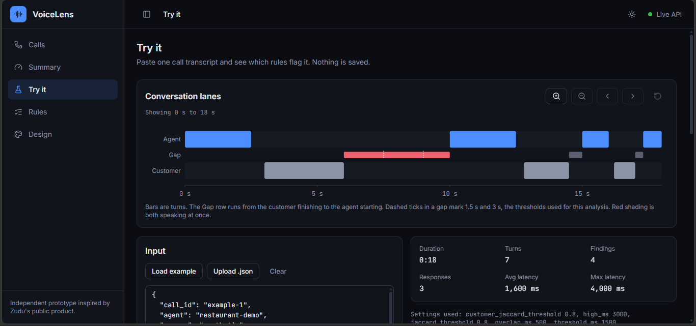
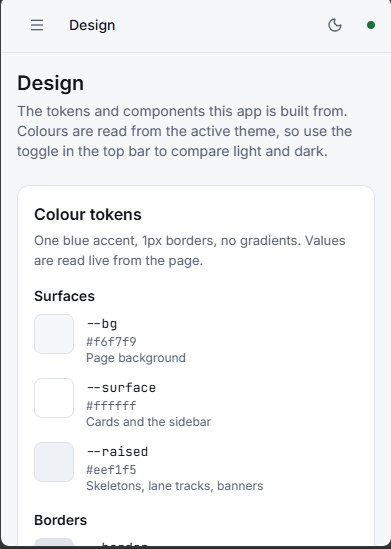

# VoiceLens

**See where an AI voice agent failed the customer, and the exact turn where it happened.**

[](https://voicelens-two.vercel.app)


VoiceLens is an independent prototype inspired by Zudu's public product. It is a call-quality inspector for AI voice agents: it imports call transcripts (JSON or CSV), runs six deterministic rules, flags the places where the agent may have failed the customer, and links every finding to the exact transcript turn as evidence. A reviewer can confirm or dismiss each finding.

**Live demo (read-only):** https://voicelens-two.vercel.app. Open the Try it page and paste your own transcript. The API runs on a free tier that sleeps when idle, so the first load can take up to a minute. The app shows a saved snapshot with a Retry button while it wakes up.



## At a glance

| | |
| --- | --- |
| Rules | 6, all plain code over text and timestamps |
| AI in the analysis | None. No language model, no paid API |
| Bundled data | 5 synthetic calls, written by hand |
| Accuracy number | None, on purpose. The rules are not validated on real calls |
| Pages | Calls, Call inspector, Summary, Try it, Rules, Design |
| Public deploy | Read-only: importing and reviewing are switched off |

## A finding, end to end

This is a call from the bundled data (`synthetic-reservation-001`), and the finding VoiceLens raises on it:

```text
Turn 0  Agent     Hello, what date would you like to reserve?
Turn 1  Customer  Next Friday evening
Turn 2  Agent     What date would you like to reserve?
Turn 3  Customer  I said next Friday evening
Turn 4  Agent     What date would you like to reserve?
```

- **Finding 1, medium, `repeated_agent_turn`, turn 2:** the agent said almost the same thing again instead of moving the call forward. Evidence: it repeats turn 0 (similarity 0.88).
- **Finding 2, medium, `repeated_agent_turn`, turn 4:** the same, repeating turn 2 (similarity 1.00).

In the app, each finding has a "Go to turn" button that scrolls the transcript to that turn. You can confirm it, dismiss it, or add a note.

## How it works

```text
Saved calls
  Import (JSON or CSV) -> six rules -> SQLite -> Flask API -> React app

Try it
  Paste one call -> POST /analyze -> six rules -> findings shown, nothing saved
```

## Why it is built this way

- **Deterministic rules.** The same transcript always gives the same findings, and every finding can be traced to a rule and a turn. There is no model to second-guess.
- **The backend owns every number.** Findings and latencies are computed in Flask. The frontend only displays them, so the two can never disagree.
- **Honest about accuracy.** The Summary page says "No labels yet" until real calls are hand-labelled. See [docs/accuracy.md](docs/accuracy.md).
- **Safe to leave public.** With `READ_ONLY` on, the server refuses imports and reviews, and the app switches those controls off and says why.
- **Works when the API is down.** If the API does not answer within 8 seconds, the app shows a saved snapshot of the synthetic data and offers Retry.

## What this is, and what it is not

- **Independent.** Zudu did not ask for it, does not use it, and it does not touch Zudu's platform. It is only inspired by what Zudu shows publicly.
- **Synthetic data only.** The five calls that ship with it were written by hand to exercise the rules. No real calls were collected or labelled.
- **Not validated.** None of the rules has been validated on real calls. The accuracy section of the Summary page says "No labels yet" and will keep saying so until real calls are hand-labelled. There is no accuracy number anywhere in this project. See [docs/accuracy.md](docs/accuracy.md).
- **No AI in the analysis.** The rules are plain code over text and timestamps. There is no language model, no paid API and no network call in the path that produces a finding.
- **No raw audio.** Only transcript text is stored or shown. Audio files and the `backend/data/drafts/` folder are git-ignored.

## Screenshots

Taken by hand in Microsoft Edge on Windows, with the bundled synthetic data. The desktop screenshots are about 1366 px wide and the phone-width one is about 390 px wide. Nothing in them is real call data.



*Summary, dark theme, synthetic calls.*



*Call inspector, dark theme: transcript and findings side by side.*



*Try it, dark theme: the example call, analysed without saving anything.*



*Design page, light theme, phone width.*

## Pages

| Page | What it does |
| --- | --- |
| Calls | Search, filter, sort and page through imported calls. |
| Call inspector | One call: stats, a timeline strip of findings, the conversation lanes view (who spoke when, and the response gaps), the transcript and the findings. Confirm, dismiss or add a note to each finding. Keys: j and k step through findings, Esc clears. |
| Summary | Metrics for real, synthetic or all calls, a findings-per-rule chart, the accuracy section and an import card. |
| Try it | Paste one call as JSON and see the findings at once. Nothing is saved. You can change the rule thresholds and the rules run again. |
| Rules | Every rule, its settings and its known limits. |
| Design | The colour tokens, a live contrast check and the components, in the active theme. |

There is a light and a dark theme. The app follows your system setting until you pick one with the toggle in the top bar, then remembers your choice.

If the API cannot be reached, or does not answer within 8 seconds, the app shows a saved read-only snapshot of the bundled synthetic data and says so in a banner with a Retry button. When the server runs with `READ_ONLY` on, importing calls and reviewing findings are switched off in the app, with a message that says why.

## The six rules

Every rule is unvalidated, and each has known limits. The full list is on the Rules page and in [docs/accuracy.md](docs/accuracy.md).

| Rule | Flags | Needs | Default settings |
| --- | --- | --- | --- |
| `high_latency` | An agent turn that starts too long after the customer finished. Medium above the base threshold, high above the high one. | Timestamps | 1500 ms and 3000 ms |
| `repeated_agent_turn` | An agent turn that says almost the same thing as the agent's previous turn. | Nothing extra | Word overlap 0.8 |
| `ignored_constraint` | An agent confirmation that contradicts what the customer just asked for: a different quantity, a non-vegetarian item for a vegetarian request, an excluded ingredient, or a smoking room for a non-smoking request. | Agent name starting with restaurant or hotel | None |
| `false_success_claim` | An agent turn that claims success right after a tool call failed. | `tool_events` | None |
| `agent_talking_over_customer` | An agent turn that starts while the customer's previous turn was still going. | Timestamps | Overlap above 500 ms (a guess) |
| `customer_repeated_themselves` | A customer turn that says almost the same thing as the customer's previous turn. | Nothing extra | Word overlap 0.8, at least 3 words |

## Stack

- **Frontend:** React 19, JavaScript, Vite 8, React Router 7, Tailwind CSS 4, Recharts, lucide-react, Vitest and React Testing Library.
- **Backend:** Python 3.12, Flask 3, Flask-SQLAlchemy (SQLAlchemy pinned to 2.0.x), SQLite, pytest, and gunicorn for production.
- The backend computes every finding and latency number. The frontend displays them.

## Quick start

Developed and tested on Windows with PowerShell. The commands below are the PowerShell ones.

Backend, in one terminal:

```powershell
cd backend
python -m venv .venv
.venv\Scripts\Activate.ps1
pip install -r requirements.txt
python seed.py
python run.py
```

`python run.py` starts the Flask development server on http://127.0.0.1:5000. It is not meant for production.

Frontend, in a second terminal:

```powershell
cd frontend
npm install
npm run dev
```

Open http://localhost:5173. The dev server proxies `/api` to the backend.

`python seed.py` loads the calls in `backend/data/` and skips any call that is already saved. Do not run `python seed.py --reset` if you want to keep anything: it deletes all data, including review decisions.

## Configuration

Everything has a default, so no configuration is needed to run locally.

| Variable | Default | Meaning |
| --- | --- | --- |
| `DATABASE_URL` | `backend/voicelens.db` | Database location. |
| `CORS_ORIGINS` | `http://localhost:5173` | Allowed browser origins, comma separated. |
| `LATENCY_THRESHOLD_MS` | `1500` | Responses slower than this are flagged. |
| `LATENCY_HIGH_MS` | `3000` | Responses slower than this are high severity. |
| `READ_ONLY` | off | Set to `1`, `true`, `yes` or `on` to make importing calls and reviewing findings return 403. Reads and `POST /analyze` keep working. Meant for a public demo. |
| `VITE_API_BASE` | `/api/v1` | Where the frontend finds the API. |
| `VITE_API_MODE` | live | Set to `snapshot` to force the bundled read-only snapshot. |
| `VITE_API_TIMEOUT_MS` | `8000` | How long the frontend waits for the API before it falls back to the saved snapshot. |

The backend reads its variables from the environment, or from a `.env` file next to `backend/config.py`. Vite reads the `VITE_` ones from a `.env` file in the `frontend` folder.

## Importing calls

Import from the Summary page, or `POST /api/v1/import`. A call looks like this:

```json
{
  "call_id": "demo-001",
  "agent": "restaurant-demo",
  "source": "synthetic",
  "started_at": "2026-10-20T10:00:00Z",
  "outcome": "completed",
  "turns": [
    { "i": 0, "speaker": "agent", "text": "Welcome, what can I get you?", "start_ms": 0, "end_ms": 2500 },
    { "i": 1, "speaker": "customer", "text": "Two vegetarian thalis please", "start_ms": 3000, "end_ms": 4800 }
  ],
  "tool_events": [{ "after_turn": 1, "name": "create_order", "status": "ok" }]
}
```

- `source` is `real` or `synthetic`. Mark a call `real` only if you recorded it yourself from a real agent. Synthetic calls stay out of the accuracy numbers.
- Turns are numbered 0, 1, 2 and so on. `speaker` is `agent` or `customer`. `start_ms` and `end_ms` are optional whole milliseconds. Without them the latency and overlap rules cannot run.
- `tool_events` is optional. `status` is `ok` or `failed`.
- A CSV has one row per turn. Required columns: `call_id`, `agent`, `source`, `i`, `speaker`, `text`. Optional: `started_at`, `outcome`, `start_ms`, `end_ms`. A CSV cannot carry tool events.
- An import is all-or-nothing: if any call is invalid, nothing is saved. A call id that already exists is skipped.
- `frontend/public/sample-calls.json` is a sample file, marked synthetic.

## API

All paths are under `/api/v1`. Errors look like `{"error": {"code": 422, "message": "...", "details": ["..."]}}`, where `details` is optional.

| Request | Purpose |
| --- | --- |
| `GET /health` | Liveness check. |
| `GET /mode` | `{"read_only": true}` when the server runs with `READ_ONLY` on, otherwise `false`. The frontend uses it to switch off import and review. |
| `GET /rules` | The rule catalog with settings, defaults, limits, and the languages that have phrase lists. |
| `POST /analyze` | Analyse one call without saving it. Optional `settings`: `threshold_ms`, `high_ms`, `jaccard_threshold`, `overlap_ms`, `customer_jaccard_threshold`. Limits: 256 KB and 500 turns. Stays open when `READ_ONLY` is on. |
| `POST /import` | Import a call or a list of calls, as a JSON body or an uploaded `.json` or `.csv` file. Returns 403 when `READ_ONLY` is on. |
| `GET /calls` | List calls. Parameters: `q`, `agent`, `source`, `severity`, `sort`, `order`, `page`, `page_size`. |
| `GET /calls/<call_id>` | One call: stats, turns with latency, tool events and findings. |
| `PATCH /findings/<id>` | Set `status` (`open`, `confirmed` or `dismissed`) and/or `note`. Returns 403 when `READ_ONLY` is on. |
| `GET /summary` | Metrics and the accuracy section. `?source=real`, `synthetic` or `all` (default `real`). |

## Deployment

The public demo is deployed as a read-only copy: the API on Render's free tier and the frontend on Vercel. `render.yaml` and `frontend/vercel.json` hold the settings.

**API on Render.**

- `render.yaml` defines one free Python web service built from the `backend` folder. It starts `gunicorn wsgi:app --workers 1 --threads 2 --bind 0.0.0.0:$PORT` with `READ_ONLY=1` and `PYTHON_VERSION=3.12.9`. gunicorn does not run on Windows, so use `python run.py` locally.
- Render asks for `CORS_ORIGINS` when the Blueprint is first created. Give it the frontend's origin, for example `https://your-app.vercel.app`, with no trailing slash. Afterwards, change it in the Render dashboard.
- Render's free tier spins a service down after 15 minutes without traffic, and its disk is not kept. So `backend/wsgi.py` fills an empty database from `backend/data` on every start. Any review a visitor made is gone after a restart, which does not matter here because `READ_ONLY` blocks reviews anyway.
- The first request after a spin-down is slow. The frontend gives up after 8 seconds, shows the saved snapshot and offers Retry.

**Frontend on Vercel.**

- Import the repository and set the Root Directory to `frontend`, with the Vite framework preset.
- Set `VITE_API_BASE` to the API address plus `/api/v1`, for example `https://your-api.onrender.com/api/v1`. Vite reads it at build time, so redeploy after changing it.
- `frontend/vercel.json` sends every path to `index.html`, so a reload on a React Router URL does not give a 404.

The frontend's address is not known until it is deployed. Deploy the API first with a temporary `CORS_ORIGINS`, deploy the frontend, then set `CORS_ORIGINS` to the real address. Preview deployments on other addresses are blocked by `CORS_ORIGINS` and fall back to the snapshot.

## Tests

Backend:

```powershell
cd backend
.venv\Scripts\Activate.ps1
python -m pytest -q
```

Frontend:

```powershell
cd frontend
npm test
npm run lint
npm run build
```

The frontend tests run in jsdom, which has no layout. Layout, the themes and the charts were checked by hand in Microsoft Edge on Windows. Other browsers and screen readers have not been tested.

The bundled snapshot is regenerated with `python export_fixtures.py` from the `backend` folder. It seeds a throwaway in-memory database from the files in `backend/data/` and never reads the live database. Run it again whenever the API shapes or the bundled data change.

## Project layout

```text
backend/
  app/            Flask app: routes, services (rules, analyzer, importer, seeder), models
  data/           synthetic.json, real_excerpts.json, labels.json (drafts/ is git-ignored)
  tests/          pytest suite
  config.py       settings read from the environment
  run.py          development server
  wsgi.py         production entry point, seeds an empty database
  seed.py         loads backend/data into the database
  export_fixtures.py   regenerates the frontend snapshot
frontend/
  src/            components, pages, hooks, lib, services (API client and snapshot), fixtures
  test/           Vitest tests
  public/         sample-calls.json
  vercel.json     single-page-app rewrite
docs/             accuracy.md and the README screenshots
render.yaml       Render Blueprint for the API
```

## Known limitations

- The latency chips in the transcript use a fixed 1.5 s cutoff, even when you change the thresholds on the Try it page.
- The lanes view in the call inspector always marks 1.5 s and 3 s, because the call API does not return the thresholds a call was analysed with.
- In the dark theme, field and outline-button borders measure 1.50:1 against the 3:1 guideline for interface components. The "normal" gap bars in the lanes view measure about 2.9:1 in dark and 2.6:1 in light. The Design page shows the live contrast numbers.
- A saved call is not analysed again when a rule changes. See [docs/accuracy.md](docs/accuracy.md).
- There is no login. Unless `READ_ONLY` is on, anyone who can reach the server can import calls and review findings.
- The data is a single SQLite file. On Render's free tier it is rebuilt from `backend/data` on every start.

## Out of scope

Telephony, speech models, an agent builder, authentication, billing, importers for other vendors' formats, and any language model in the analysis path.
